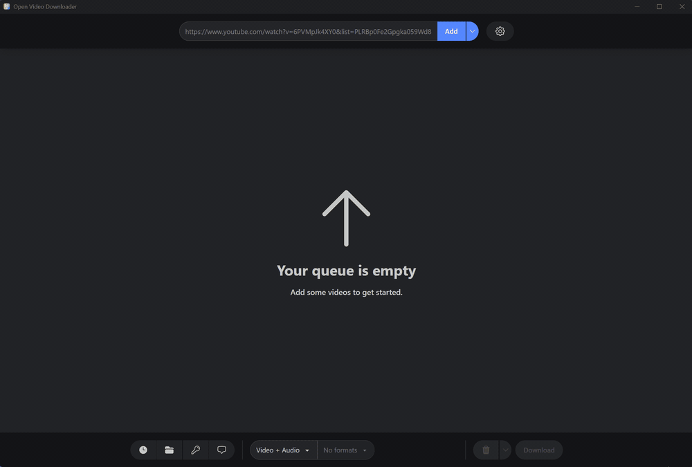

<div align="center">


# Open Video Downloader

**Download videos, audio and subtitles from hundreds of websites. No command line needed.**

[](https://github.com/indep-arg/youtube-dl-gui/releases/latest)
[](https://github.com/indep-arg/youtube-dl-gui/releases)
[](./LICENSE)
[](#download)
[](https://github.com/indep-arg/youtube-dl-gui/actions/workflows/vue-ci.yml)

[Download](#download) · [Features](#features) · [User guide](./docs/GUIDE.md) · [Changelog](./CHANGELOG.md)

</div>

> **This is an independent fork**, maintained by [indep-arg](https://github.com/indep-arg). It is not affiliated
> with or endorsed by the original project. See [Credits](#credits).

Open Video Downloader is a simple desktop app for Windows and Linux. Paste a link, pick what you want and
download it. It works with YouTube and hundreds of other sites, and it uses
[yt-dlp](https://github.com/yt-dlp/yt-dlp) behind the scenes, so you never have to touch a terminal.

<p align="center">
  
</p>

## Features

- **Video or audio.** Choose the quality and format, or keep only the sound.
- **Playlists and live streams.** Grab a whole playlist at once or record a live stream.
- **Subtitles and details.** Save captions, descriptions and video information, or split a video by chapters.
- **Smart queue.** Several downloads run at the same time, and unfinished ones are still there when you reopen the app.
- **History.** See what you downloaded, open its folder or download it again.
- **Your own rules.** Pick folders and file names, with different settings for each website.
- **Speed control.** Limit the speed and choose how many times a failed download is retried.
- **Sites that need a login.** Use your browser cookies, a username and password, or a video password.
- **Always up to date.** The app and its tools update themselves.
- **Private.** No tracking, no accounts and no error reports. Only your downloads and update checks leave your computer. [More details](./docs/PRIVACY.md).
- **Light and dark theme.** It follows your system.

## What's different from the original

This fork started from the original app and keeps going on its own:

- **New features:** record live streams, a history of your downloads, a queue that survives closing the app,
  settings for each website, speed and retry limits, and settings you can export and import.
- **Bug fixes:** ffmpeg no longer crashes on some Linux systems such as Fedora, and many layout problems
  are gone, like the white strip on Linux, text cut off in longer languages and unreadable text in the light theme.
- **Its own updates:** new versions and tools are published and signed from this repository.
- **Fewer platforms:** only Windows and Linux. There are no macOS builds.

Every change is listed in the [changelog](./CHANGELOG.md).

## Download

Get the latest version from the [Releases page](https://github.com/indep-arg/youtube-dl-gui/releases/latest)
and install it as usual. The first time you open the app it downloads the extra tools it needs, so just wait a moment.

| System                | Recommended file                              | Other options                                                  |
|-----------------------|-----------------------------------------------|----------------------------------------------------------------|
| **Windows**           | `Open.Video.Downloader_x.x.x_x64-setup.exe`   | `…_x64-portable.zip` if you prefer no installation             |
| **Linux**             | `Open.Video.Downloader_x.x.x_amd64.AppImage`  | `.deb` for Debian and Ubuntu, `.rpm` for Fedora                |

On a computer with an ARM processor, use the files with `arm64` or `aarch64` in the name instead of `x64` or `amd64`.

## Help

- [User guide](./docs/GUIDE.md): how to use the app and what to do when something goes wrong.
- [Report a problem or suggest an idea](https://github.com/indep-arg/youtube-dl-gui/issues).
- [Translate the app](./docs/TRANSLATING.md) into your language.

## Contributing

Contributions are welcome. The app is built with Vue 3 and Rust, using [Tauri](https://tauri.app/).
To try it yourself you need Node.js 24 or newer and Rust:

```sh
npm install
npm run tauri dev
```

See [CONTRIBUTING.md](./CONTRIBUTING.md) for the details.

## License

Open Video Downloader is released under the [AGPL-3.0 license](./LICENSE).

### Credits

This project is a fork of [youtube-dl-gui / Open Video Downloader](https://github.com/jely2002/youtube-dl-gui),
created by **Jelle Glebbeek ([jely2002](https://github.com/jely2002))** and contributors, who hold the copyright
on the original code. All original copyright and license notices are kept, as the AGPL-3.0 requires.

Changes made in this fork are also released under the AGPL-3.0-or-later and are recorded in the git history.
The [wiki](https://github.com/jely2002/youtube-dl-gui/wiki) is still provided by the original project.

### Use it responsibly

The maintainers cannot be held liable for misuse of this application, as stated in section 16 of the AGPL-3.0.
We do not condone using it to break local laws or the terms of service of a website, including the DMCA.
Each user is responsible for using it fairly and within the law.
