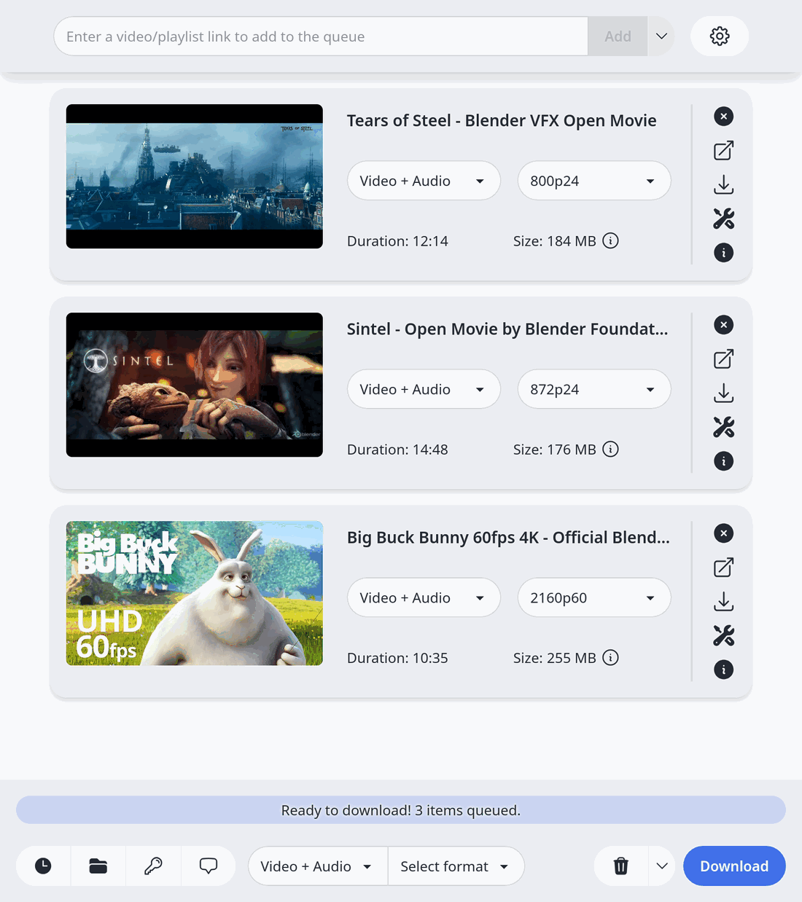
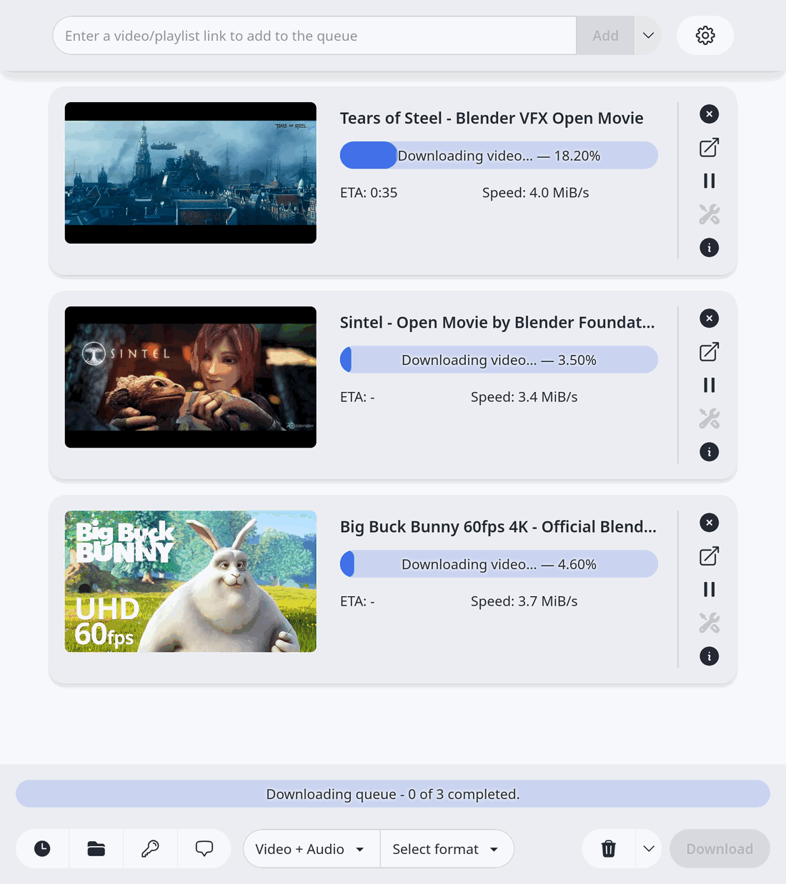
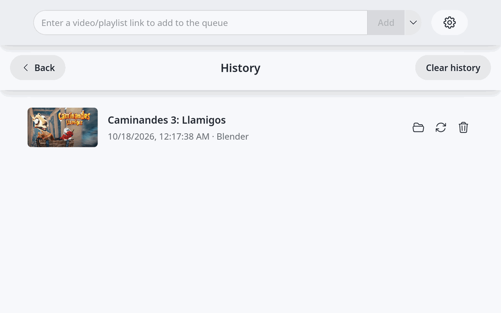
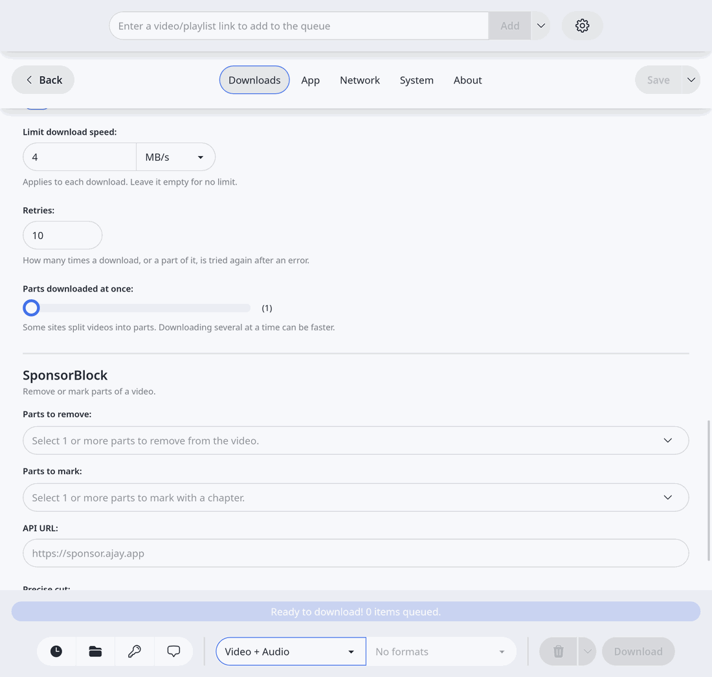

# Open Video Downloader (youtube-dl-gui) <br>   

> **This is an independent fork.** It is maintained by [indep-arg](https://github.com/indep-arg) and is based on
> [jely2002/youtube-dl-gui](https://github.com/jely2002/youtube-dl-gui) by Jelle Glebbeek and contributors.
> It is not affiliated with or endorsed by the original author. See [Credits](#credits-and-fork-notice).

Open Video Downloader is a simple desktop application for Windows and Linux that lets you download videos, audio,
subtitles and metadata from hundreds of websites, not just YouTube. It puts an easy interface around
[yt-dlp](https://github.com/yt-dlp/yt-dlp), so you don’t have to touch the command line.

## Screenshots

<table>
  <tr>
    <td width="50%">
      <picture>
        <source media="(prefers-color-scheme: dark)" srcset="./docs/images/queue-dark.png">
        
      </picture>
    </td>
    <td width="50%">
      <picture>
        <source media="(prefers-color-scheme: dark)" srcset="./docs/images/downloading-dark.png">
        
      </picture>
    </td>
  </tr>
  <tr>
    <td width="50%">
      <picture>
        <source media="(prefers-color-scheme: dark)" srcset="./docs/images/history-dark.png">
        
      </picture>
    </td>
    <td width="50%">
      <picture>
        <source media="(prefers-color-scheme: dark)" srcset="./docs/images/settings-dark.png">
        
      </picture>
    </td>
  </tr>
</table>

## Features

- **Private:** no telemetry and no error reports, which the original had. See [Privacy](#privacy).
- **Video or audio:** pick the resolution, frame rate and format (MP4, MKV…), or keep only the audio track.
- **Subtitles and metadata:** save the available captions and video information, the info file and the description, or split a video into its chapters.
- **Playlists and live streams:** download a whole playlist in one go, or record a live stream, from the start if the site allows it.
- **Smart queue:** downloads are balanced so your computer doesn’t slow down, and links that were still waiting come back when you reopen the app.
- **History:** see what you downloaded, open its folder or download it again.
- **Your own rules:** choose folders and file names with presets or templates, and set a folder and video or audio for each website.
- **Speed and retries:** limit the download speed, choose how many times to retry and how many parts download at once.
- **Sign in:** browser cookie files, basic authentication and video passwords.
- **Shortcuts and notifications:** add and download videos with keyboard shortcuts and follow the progress from notifications.
- **Settings in a file:** export your settings and import them on another computer.
- **Always up to date:** the app and its tools (yt-dlp, ffmpeg) update by themselves.
- **Light and dark mode:** follows your system theme.

## Privacy

The original app sent error reports to an outside service. This fork took that out, so there is no
telemetry, no account and nothing that tracks what you download. The only things that leave your
computer are the downloads you ask for and the checks for updates on GitHub.

Updates are signed, and the tools it downloads (yt-dlp, ffmpeg) are checked before they are used.
More in [docs/PRIVACY.md](./docs/PRIVACY.md).

## Download

Get the latest version for **Windows** or **Linux** from the
[GitHub Releases page](https://github.com/indep-arg/youtube-dl-gui/releases), then install it as usual.
No command-line setup is needed. There are no macOS builds in this fork.

### Which file do I download?

| Your computer                       | File                                             |
|-------------------------------------|--------------------------------------------------|
| **Windows (x64)**                   | `Open.Video.Downloader_x.x.x_x64-setup.exe`      |
| **Windows (ARM64)**                 | `Open.Video.Downloader_x.x.x_arm64-setup.exe`    |
| **Windows, no install (x64)**       | `Open.Video.Downloader_x.x.x_x64-portable.zip`   |
| **Windows, no install (ARM64)**     | `Open.Video.Downloader_x.x.x_arm64-portable.zip` |
| **Linux, any distribution (x64)**   | `Open.Video.Downloader_x.x.x_amd64.AppImage`     |
| **Linux, any distribution (ARM64)** | `Open.Video.Downloader_x.x.x_aarch64.AppImage`   |
| **Debian / Ubuntu (x64)**           | `Open.Video.Downloader_x.x.x_amd64.deb`          |
| **Debian / Ubuntu (ARM64)**         | `Open.Video.Downloader_x.x.x_arm64.deb`          |
| **Fedora / RHEL (x64)**             | `Open.Video.Downloader-x.x.x-1.x86_64.rpm`       |
| **Fedora / RHEL (ARM64)**           | `Open.Video.Downloader-x.x.x-1.aarch64.rpm`      |

The first time you open the app it downloads the tools it needs (yt-dlp, ffmpeg and a few more),
checks that they are the right files, and keeps them up to date.

## Documentation

- [User guide](./docs/GUIDE.md): installing, using the app and what to do when something goes wrong.
- [Privacy](./docs/PRIVACY.md)
- [Changelog](./CHANGELOG.md)
- [Contributing](./CONTRIBUTING.md)
- [Translating](./docs/TRANSLATING.md)

## Contributing

Developers are welcome to contribute. You’ll need Node.js (v24+) and Rust installed.

```sh
npm install
npm run tauri dev
```

For more details, see [CONTRIBUTING.md](./CONTRIBUTING.md).
It is built with Vue 3 and a Rust backend powered by [Tauri](https://tauri.app/).

## License and disclaimer

Open Video Downloader is distributed under the [AGPL-3.0 license](./LICENSE).

### Credits and fork notice

This project is a fork of [youtube-dl-gui / Open Video Downloader](https://github.com/jely2002/youtube-dl-gui),
created by **Jelle Glebbeek ([jely2002](https://github.com/jely2002))** and contributors, who hold the copyright
on the original code. All original copyright and license notices are preserved, as required by the AGPL-3.0.

Changes made in this fork are also released under the AGPL-3.0-or-later, and are recorded in the git history of
this repository. The fork is maintained by [indep-arg](https://github.com/indep-arg).
Documentation such as the [wiki](https://github.com/jely2002/youtube-dl-gui/wiki) is still provided by the original project.

### Use this application responsibly

The maintainers of Open Video Downloader cannot be held liable for misuse of this application, as stated in the
AGPL-3.0 license (section 16). We do not condone the use of this software to violate local laws or platform terms
of service (including the DMCA). Users are personally responsible for ensuring they use this software fairly and
within legal boundaries.
